<div align="center">

# 💸 ThinWallet

**Finanzas personales y gastos compartidos en un solo lugar.**
Registra ingresos y gastos, divide cuentas con amigos, detecta los "gastos hormiga" y alcanza tus metas de ahorro.


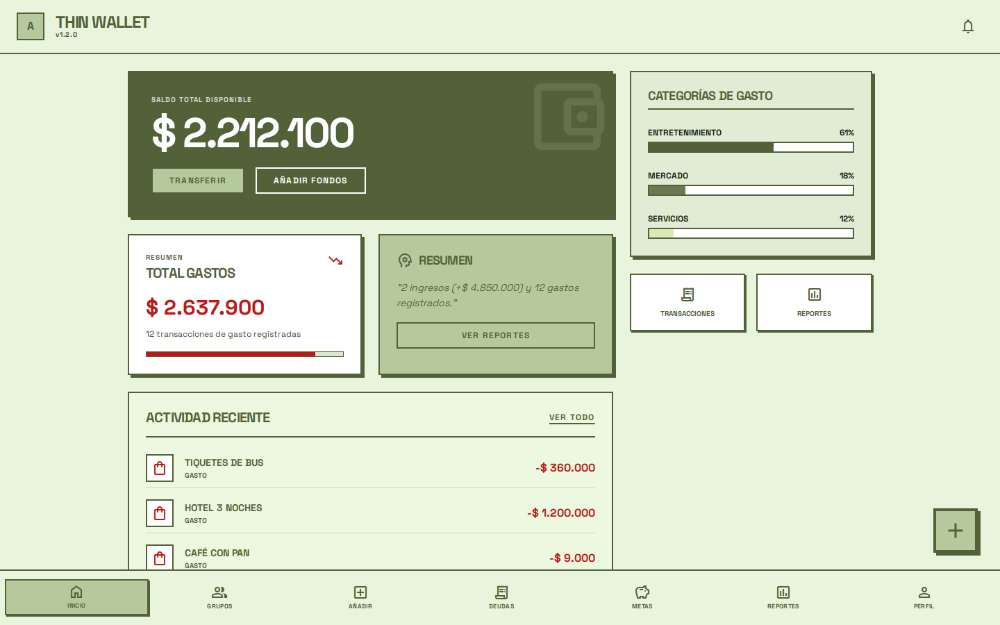

</div>

---

## 📑 Contenido

- [Qué hace](#-qué-hace)
- [Capturas](#-capturas)
- [Arquitectura](#-arquitectura)
- [Patrones de diseño](#-patrones-de-diseño)
- [Tecnologías](#-tecnologías)
- [Estructura del proyecto](#-estructura-del-proyecto)
- [Cómo ejecutarlo en local](#-cómo-ejecutarlo-en-local)
- [Cómo probarlo](#-cómo-probarlo)
- [API REST](#-api-rest)
- [Documentación técnica](#-documentación-técnica)

---

## ✨ Qué hace

| Módulo | Descripción |
|---|---|
| **Cuenta y seguridad** | Registro con verificación por correo, inicio de sesión con JWT, recuperación de contraseña y acceso de invitados con token personal. |
| **Transacciones** | Ingresos y gastos en varias monedas (COP, USD, EUR, MXN, ARS) con conversión automática a COP. |
| **Círculos de gasto** | Grupos (amigos, pareja, familia) con presupuesto común; los gastos se dividen en deudas entre los miembros. |
| **Invitados "fantasma"** | Puedes añadir a alguien que aún no tiene cuenta; luego reclama su perfil con un token y conserva su historial. |
| **Deudas** | Cuentas por cobrar y por pagar, con confirmación de pago por ambas partes. |
| **Metas de ahorro** | Metas personales y grupales con abonos y barra de progreso. |
| **Coach financiero** | Recomendaciones según la regla 50/30/20 a partir de tus ingresos reales. |
| **Gastos hormiga** | Detecta micro‑gastos repetidos bajo un umbral y muestra cuánto suman. |
| **Gastos programados** | Pagos recurrentes (diarios, semanales, mensuales…) con recordatorio por notificación push. |
| **Reportes** | Gráficas de ingresos vs. gastos y por categoría, exportables a **PDF** y **CSV**. |
| **Tiempo real** | El saldo se actualiza en vivo mediante Server‑Sent Events. |
| **Auditoría** | Cada acción relevante queda registrada en MySQL (triggers) y la actividad de los círculos en MongoDB. |

---

## 📸 Capturas

> Tomadas con el proyecto corriendo en local y los [datos de demostración](#5-cargar-datos-de-demostración-opcional).

### Acceso

| Inicio de sesión | Registro |
|---|---|
| 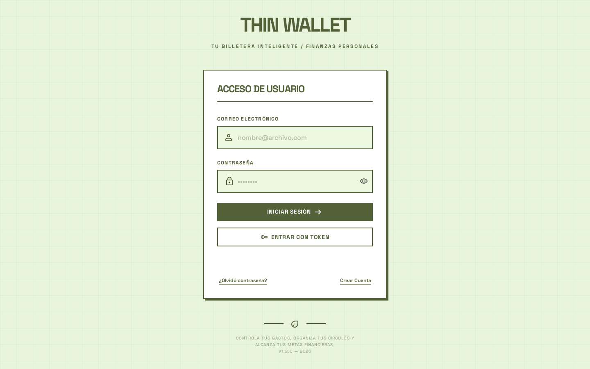 | 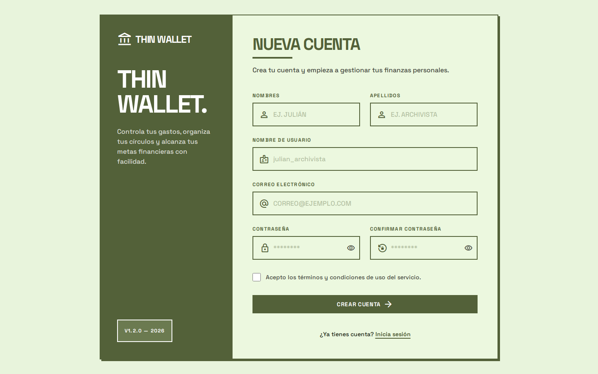 |

### Finanzas personales

| Dashboard | Historial de transacciones |
|---|---|
|  | 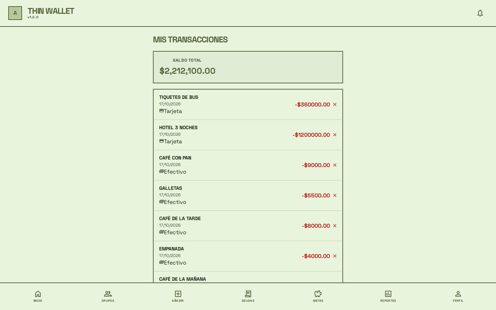 |

| Nueva transacción | Reportes (PDF / CSV) |
|---|---|
| 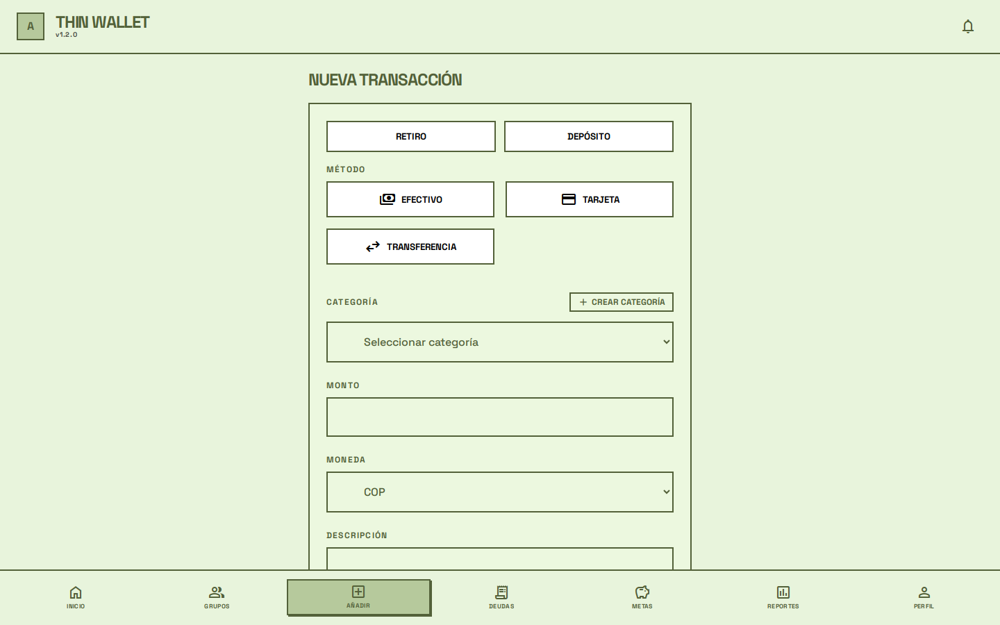 | 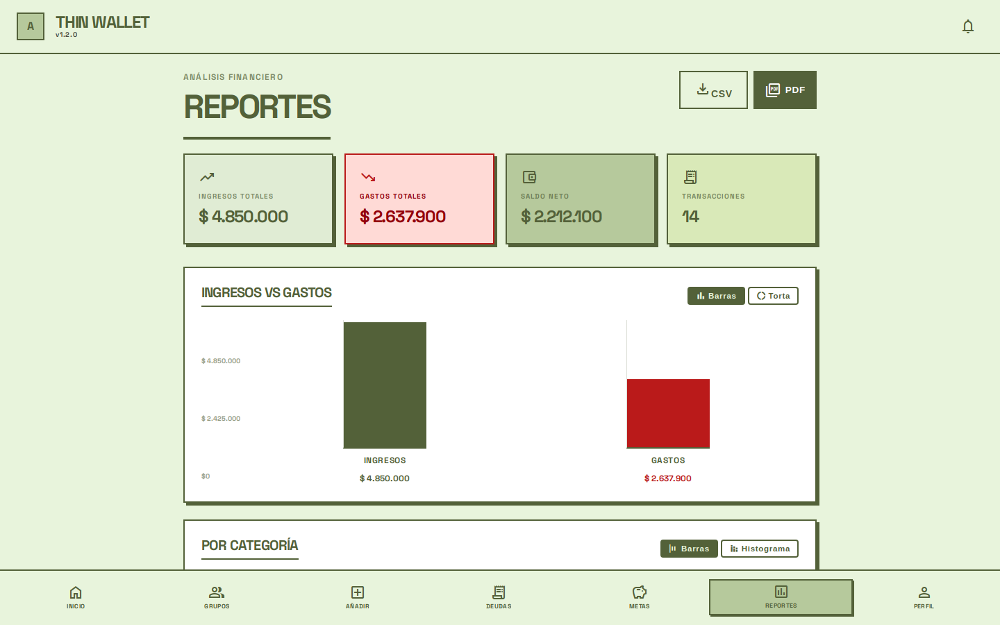 |

| Metas de ahorro y coach 50/30/20 | Gastos hormiga |
|---|---|
| 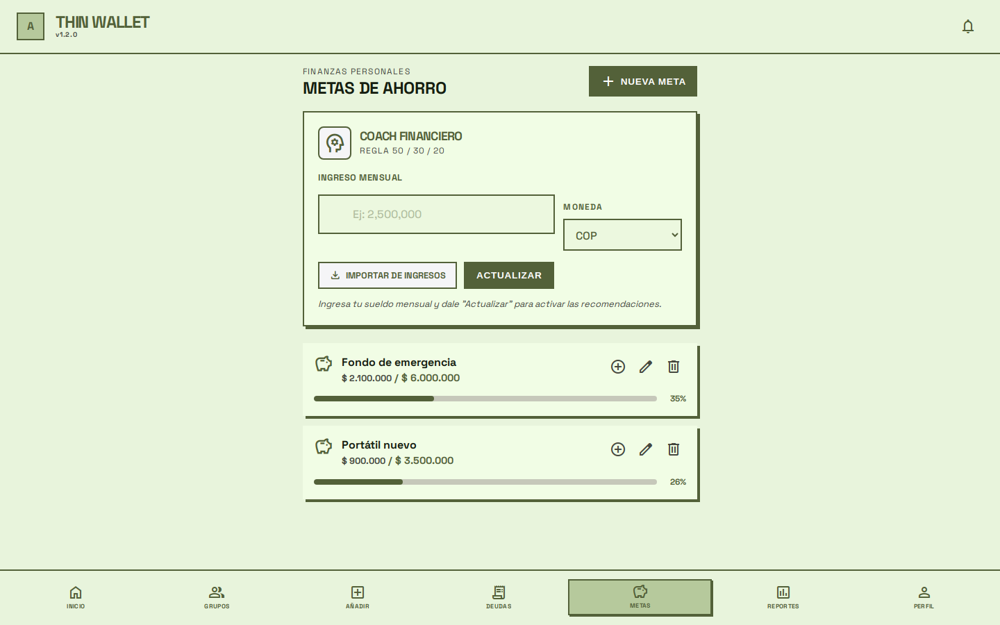 | 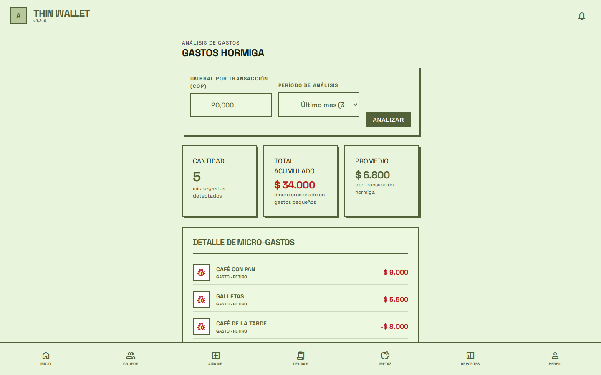 |

| Gastos programados | Perfil |
|---|---|
| 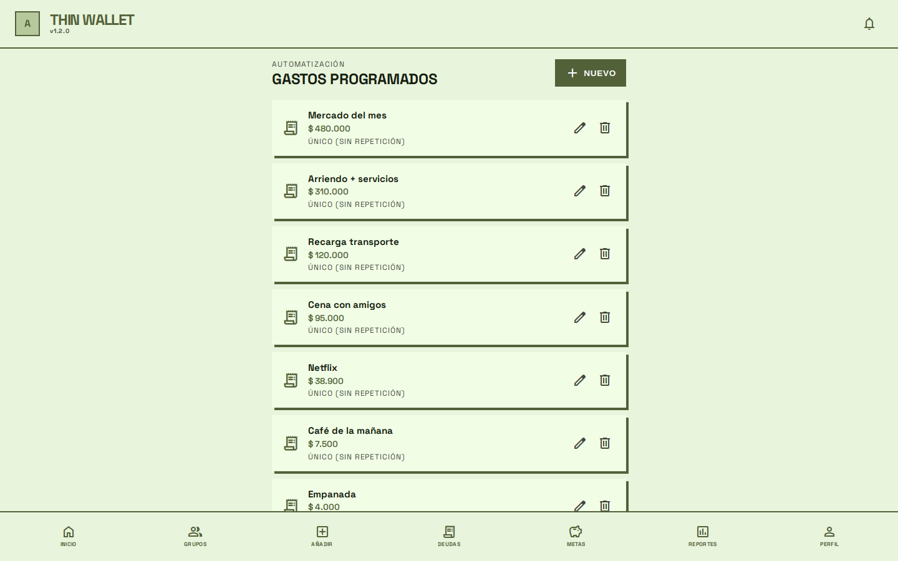 | 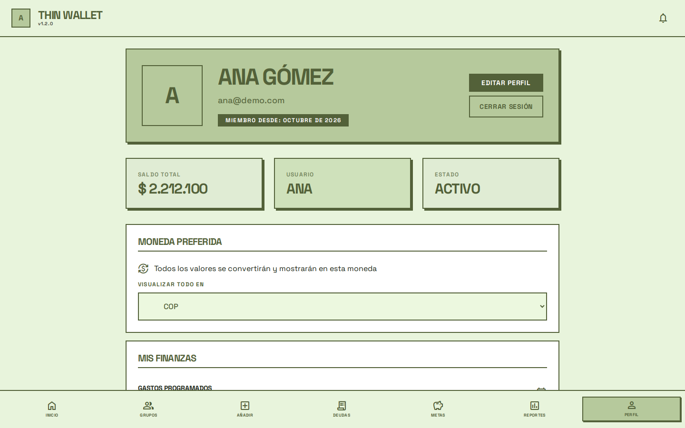 |

### Gastos compartidos

| Círculos de gasto | Detalle de un círculo |
|---|---|
| 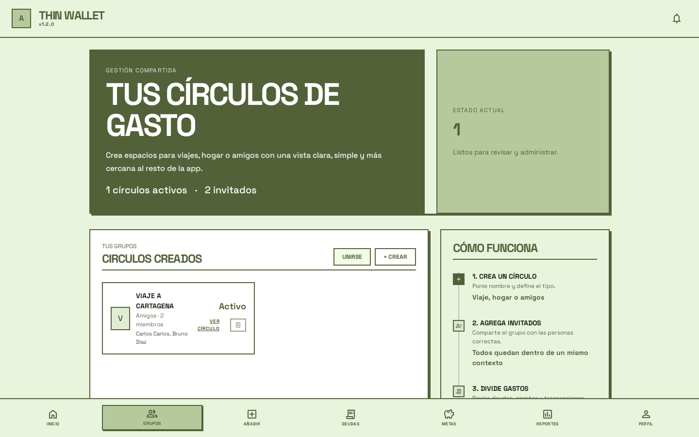 | 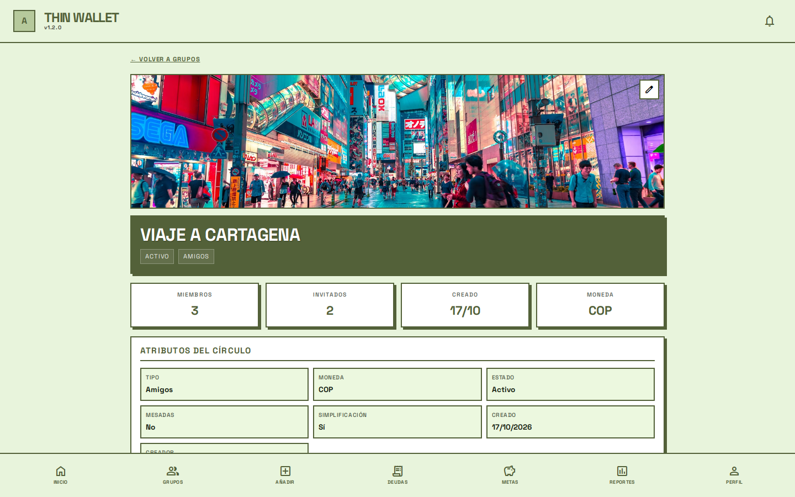 |

| Flujo de deudas |
|---|
| 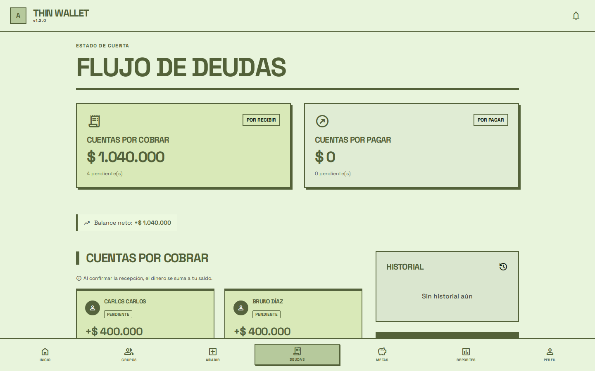 |

### Versión móvil

<p>
  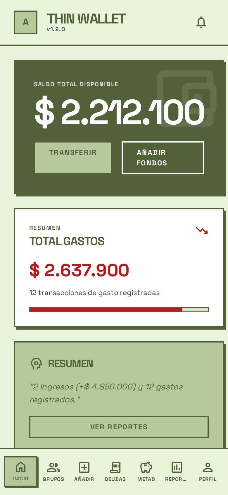
  &nbsp;&nbsp;
  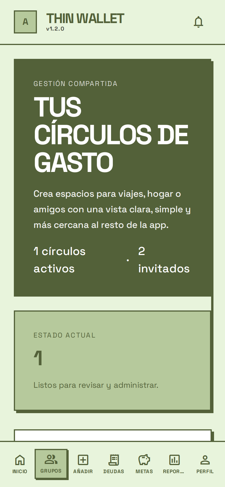
</p>

---

## 🏗 Arquitectura

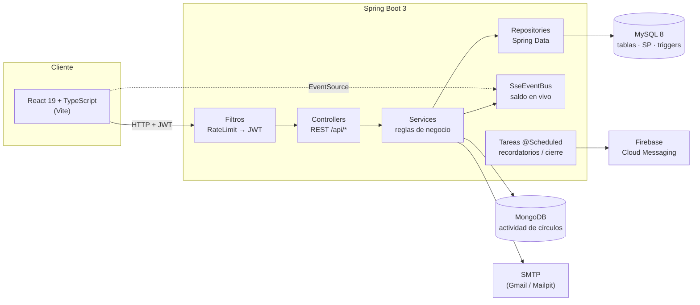

**Flujo de una petición:** el frontend envía el JWT en la cabecera `Authorization`; `RateLimitFilter` limita a 120 peticiones/minuto por IP; `JwtAuthenticationFilter` valida el token; el controlador delega en un servicio, que usa repositorios JPA y, para la lógica financiera pesada (dividir deudas, balances, mesadas), **procedimientos almacenados** de MySQL.

---

## 🧩 Patrones de diseño

| Patrón | Dónde se aplica | Para qué |
|---|---|---|
| **Arquitectura en capas (MVC)** | `controller/` → `service/` → `repository/` | Cada capa tiene una sola responsabilidad: HTTP, negocio y datos. |
| **Repository** | `repository/*Repository.java` (Spring Data JPA y MongoDB) | Aísla el acceso a datos de la lógica de negocio. |
| **DTO** | `request/` (entrada) y `dto/` (salida) | Desacopla el contrato de la API de las entidades JPA. |
| **Strategy** | `store/ICategoriaStore` con `CategoriaJpaStore` y `CategoriaMongoStore` | El mismo servicio guarda categorías en MySQL o MongoDB según el perfil activo (`sql` / `mongo`). |
| **Inyección de dependencias** | Constructores con `@RequiredArgsConstructor` | Bajo acoplamiento y clases fáciles de probar. |
| **Chain of Responsibility** | `RateLimitFilter` → `JwtAuthenticationFilter` → `SecurityFilterChain` | Cada filtro decide si la petición sigue o se corta. |
| **Observer / Publish‑Subscribe** | `SseEventBus` | Los cambios de saldo se publican a todas las pestañas abiertas del usuario. |
| **Bucket** (MongoDB) | colección `actividad_circulo_diaria` | Agrupa hasta 500 eventos por círculo y día en un documento: menos documentos, lecturas más rápidas. |
| **Approximation** (MongoDB) | colección `indicadores_circulo` | Recalcula los indicadores cada 10 eventos en lugar de en cada uno. |
| **Provider / Context** (React) | `AuthContext`, `CurrencyContext`, `TransactionContext` | Estado global (sesión, moneda) sin pasar props por toda la app. |
| **Custom Hook** | `useSaldoStream` | Encapsula la conexión SSE y su limpieza. |
| **Service layer** (frontend) | `src/services/*.ts` sobre un cliente `api.ts` único | Un solo punto para la URL base, el token y el manejo de errores. |
| **Protected Route** | `PrivateRoute`, `PublicRoute`, `NonGhostRoute` en `App.tsx` | Controla el acceso a cada pantalla según la sesión. |
| **Lazy loading** | `lazyPage()` en `App.tsx` | Cada página se descarga solo cuando se visita (bundle inicial: 825 KB → 185 KB). |

---

## 🛠 Tecnologías

| Capa | Tecnologías |
|---|---|
| **Backend** | Java 17, Spring Boot 3.2 (Web, Security, Data JPA, Data MongoDB, Validation, Mail), JJWT, iText 7 (PDF), Firebase Admin, Lombok |
| **Frontend** | React 19, TypeScript, Vite, React Router 7, Recharts, Axios, Firebase (push) |
| **Bases de datos** | MySQL 8 (tablas, 13 funciones/procedimientos, 12 triggers, 5 reportes, 16 índices) y MongoDB |
| **Despliegue** | Backend en Fly.io (`Dockerfile`, `fly.toml`), frontend en Vercel (`vercel.json`) |

---

## 📂 Estructura del proyecto

```
ThinWallet/
├── Backend/                         API REST (Spring Boot + Maven)
│   └── src/main/java/co/edu/unbosque/
│       ├── config/                  seguridad, filtros, CORS, seeders, manejo de errores
│       ├── controller/              18 controladores REST
│       ├── service/                 reglas de negocio, correo, SSE, PDF, tareas programadas
│       ├── repository/              acceso a datos (JPA y MongoDB)
│       ├── entity/  document/       modelo relacional y documental
│       ├── request/ dto/            contratos de entrada y salida
│       └── store/                   estrategia de almacenamiento de categorías
├── Frontend/                        SPA (React + TypeScript + Vite)
│   └── src/
│       ├── pages/                   una carpeta por pantalla
│       ├── components/              componentes reutilizables (common, layout, category…)
│       ├── context/  hooks/         estado global y hooks propios
│       ├── services/                llamadas a la API
│       └── utils/                   validaciones y monedas
├── database/
│   ├── mysql/                       01_schema → 05_indices (se ejecutan en orden)
│   ├── mongodb/                     inicialización de colecciones de auditoría
│   ├── demo/seed_demo.py            datos de demostración vía API
│   └── setup.sh                     crea todo con un solo comando
└── docs/
    ├── DOCUMENTACION.md             documentación técnica completa
    └── screenshots/                 capturas de este README
```

---

## 🚀 Cómo ejecutarlo en local

### Requisitos

| Herramienta | Versión |
|---|---|
| Java (JDK) | 17+ |
| Maven | 3.8+ |
| Node.js | **20.19+ o 22.12+** (lo exige Vite 8) |
| MySQL | 8.x o superior (probado con 9.7) |
| MongoDB | 6.x o superior (probado con 8.3) |
| [Mailpit](https://mailpit.axllent.org/) | opcional: atrapa los correos de verificación en local |

### 1. Clonar

```bash
git clone https://github.com/JuaniMP/ThinWallet.git
cd ThinWallet
```

### 2. Crear las bases de datos

Con MySQL y MongoDB encendidos:

```bash
./database/setup.sh
```

El script crea `thinwallet_db` en MySQL (tablas, catálogos, funciones, triggers, reportes e índices) y prepara las colecciones de MongoDB.
Si tu MySQL tiene usuario y contraseña: `MYSQL_USER=root MYSQL_PWD=tu_clave ./database/setup.sh`. Para empezar de cero: `RESET=1 ./database/setup.sh`.

### 3. Levantar el backend

```bash
# Terminal 1 — servidor de correo de pruebas (los códigos llegan a http://localhost:8025)
mailpit

# Terminal 2 — API con el perfil dev (MySQL, MongoDB y Mailpit en localhost)
cd Backend
SPRING_PROFILES_ACTIVE=sql,dev mvn spring-boot:run
```

La API queda en `http://localhost:8080/api`.
El perfil `dev` (`application-dev.properties`) trae valores de desarrollo; **para producción** copia `Backend/.env.example`, rellena las variables reales y no actives `dev`.

### 4. Levantar el frontend

```bash
cd Frontend
cp .env.example .env      # VITE_API_URL y, si usas notificaciones, las claves de Firebase
npm install
npm run dev
```

Abre `http://localhost:5173`.

### 5. Cargar datos de demostración (opcional)

Con el backend y Mailpit corriendo:

```bash
python3 database/demo/seed_demo.py
```

Crea dos usuarios, categorías, transacciones, un círculo con un invitado, deudas y metas usando la propia API.

| Usuario | Correo | Contraseña |
|---|---|---|
| Ana Gómez | `ana@demo.com` | `Demo1234*` |
| Bruno Díaz | `bruno@demo.com` | `Demo1234*` |

---

## 🧪 Cómo probarlo

**Pruebas automatizadas**

```bash
cd Backend && mvn test       # pruebas unitarias del backend
cd Frontend && npm run lint  # análisis estático
cd Frontend && npm run build # verificación de tipos + build de producción
```

**Recorrido manual sugerido** (con los datos de demostración):

1. Entra como `ana@demo.com` y revisa el **dashboard**: saldo de $2.212.100 = ingresos $4.850.000 − gastos $2.637.900.
2. En **Grupos → Viaje a Cartagena** verás a Bruno y al invitado Carlos; en **Deudas**, los $1.040.000 que te deben.
3. En **Gastos hormiga** aparecen los 5 cafés y snacks por debajo de $20.000.
4. En **Reportes** descarga el PDF y el CSV.
5. Cierra sesión y entra como `bruno@demo.com`: en **Deudas** verás los $520.000 que le debe a Ana y podrás registrar el pago.
6. Registra un usuario nuevo: el código de verificación llega a Mailpit (`http://localhost:8025`).

---

## 🔌 API REST

Todas las rutas cuelgan de `/api` y, salvo registro, login, recuperación de contraseña y categorías, requieren `Authorization: Bearer <jwt>`.

| Recurso | Endpoints principales |
|---|---|
| Usuarios | `POST /usuarios/register` · `POST /usuarios/verify` · `POST /usuarios/login` · `POST /usuarios/login-token` · `GET /usuarios/{id}/saldo` · `PATCH /usuarios/{id}/perfil` |
| Transacciones | `GET/POST /transacciones` · `GET /transacciones/usuario/{id}` · `POST /transacciones/{id}/dividir-deudas` · `GET /transacciones/gastos-hormiga/{id}` |
| Círculos | `GET/POST /circulos-gasto` · `GET /circulos-gasto/{id}/detalle` · `POST /circulos-gasto/unirse` · `POST /circulos-gasto/{id}/invitar-registrado` |
| Deudas | `GET /deudas/deudor/{id}` · `GET /deudas/acreedor/{id}` · `PUT /deudas/{id}/confirmar` |
| Metas y programados | `GET /gastos/metas/usuario/{id}` · `GET /gastos/programados/usuario/{id}` · `PUT /gastos/{id}/meta-grupal/abonar` |
| Reportes | `GET /reportes/pdf/{id}` · `GET /reportes/csv/{id}` |
| Coach | `GET /coach/recomendacion/{id}` |
| Tiempo real | `GET /eventos/saldos/{id}` (Server‑Sent Events) |

El catálogo completo, con cuerpos de petición y respuestas, está en [`docs/DOCUMENTACION.md`](docs/DOCUMENTACION.md#6-catálogo-de-endpoints--api-rest).

---

## 📚 Documentación técnica

[`docs/DOCUMENTACION.md`](docs/DOCUMENTACION.md) incluye el modelo entidad‑relación, la descripción de cada tabla y colección, el catálogo de endpoints, el manual de usuario y las reglas de negocio.

---

<div align="center">

Hecho por **[Juanita Mejía](https://github.com/JuaniMP)** · Licencia [MIT](LICENSE)

</div>
